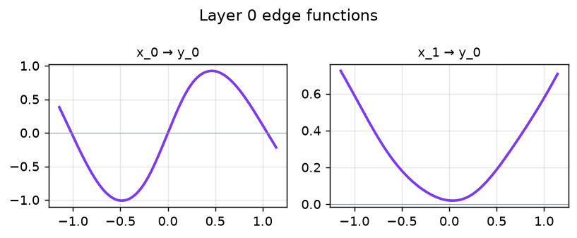
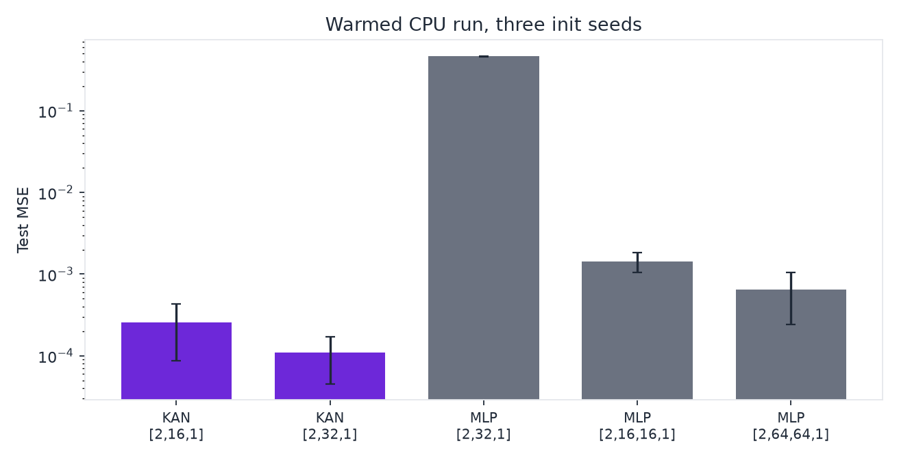

<h1 align="center">🚀 kanx</h1>

<p align="center">
  <strong>Kolmogorov-Arnold Networks for TensorFlow and PyTorch</strong><br>
  <em>A Python library with ONNX export, a FastAPI service, a CLI, and Docker and Kubernetes configs.</em>
</p>

<p align="center">
  <a href="https://pypi.org/project/kanx/"></a>
  <a href="https://pypi.org/project/kanx/"></a>
  <a href="https://pepy.tech/project/kanx">  </a>
  <a href="./CITATION.cff"></a>
  <a href="https://github.com/Mattral/KANX/actions/workflows/ci.yml"></a>
  
  <a href="https://mattral.github.io/KANX/"></a>
  <a href="https://colab.research.google.com/github/Mattral/KANX/blob/main/notebooks/quickstart.ipynb"></a>
  <a href="./LICENSE"></a>
  <a href="https://doi.org/10.5281/zenodo.20615396">
    
  </a>

</p>

> **`pip install kanx`** &nbsp;·&nbsp; On one smooth 2-D target, `sin(πx₁) + cos(2πx₂)`, KAN[2,32,1] (864 parameters) reaches a mean test MSE of 1.09×10⁻⁴. MLP[2,64,64,1] (4,417 parameters, 5.1× more) reaches 6.43×10⁻⁴. That is three init seeds on one dataset, on one CPU. The same KAN is 8.3× slower at inference (29.15 ms against 3.53 ms for 4,096 rows) and 1.6× slower to train. On UCI diabetes (one 5-fold CV run in the quickstart notebook) the TensorFlow KAN does not beat ridge regression: mean R² 0.456 against 0.490. Tables and caveats are in the benchmark section.
> One library. Two backends. ONNX export. Docker and Kubernetes configs. Prometheus metrics, TensorBoard logging, Hub and symbolic extras.

---

## ⚡ The 30-second magic moment

```python
import kanx

# Build, train, predict — in one call. No config files. No compile dance.
model = kanx.quickstart()                       # trains on synthetic 2-D data
model.predict([[0.5, 0.2]])                     # → array([[1.04…]])
```

> **⚠️ Grid calibration — two methods**
> 
> The stored knots default to `[-1, 1]` (`grid_size=5` is six knots, spacing 0.4). `extend_grid` adds `spline_order` knots of that spacing on each side, so the default cubic basis runs out to about ±2.2. The basis sums to 1 on the stored interval, is still nonzero at 1.7 (the sum is about 0.32), and is exactly zero at and beyond the outermost knot. Past that knot the layer is only the SiLU residual. Put the stored interval on the data one of two ways:
> 
> **Static approach** (pre-training):
> ```python
> from kanx import KAN, fit_grid_to_data
> model = KAN([n_features, 64, 1])
> model.build((None, n_features))               # weights exist only after build
> fit_grid_to_data(model, X_train)              # one-time grid fit
> model.fit(X_train, y_train, epochs=30)
> ```
> 
> **Adaptive approach** (during training — recommended):
> ```python
> model = KAN([n_features, 64, 1])
> model.fit(X_train, y_train, epochs=15)
> model.update_grid_from_samples(X_train)       # ← refine grid based on data
> model.fit(X_train, y_train, epochs=15)        # continue training
> ```
> 
> `kanx.check_input_range(model, X)` logs a warning when a row leaves the stored grid. That boundary is the interval you fit, which is stricter than the hard zero at the outermost knot.

Zero out edges that barely contribute. `prune` sets the spline coefficients and the base weight to zero. It does not remove the slot, and the contraction still visits it. `threshold` is an absolute cutoff on the edge score. `relative` zeros edges at or below that fraction of the strongest edge in the same layer. Pass `samples` to score each edge by its RMS on real inputs. The same method is on the PyTorch `KAN` and on `MatrixKAN`.

```python
model.prune(relative=0.01)                    # zero edges at or below 1% of the peak
model.prune(threshold=1e-3, samples=X_train)  # coefficients become zero; shapes stay
```

Plot what is left. Each edge is a learned 1-D function (SiLU residual plus B-spline). `plot_edges` needs matplotlib (`pip install "kanx[viz]"`). `write_edge_viewer` writes a single HTML file with a layer picker and a hover readout.

```python
from kanx.viz import plot_edges, write_edge_viewer

plot_edges(model, path="edges.png")
write_edge_viewer(model, "edges.html")
```

<p align="center">
  
</p>

Layer 0 of a `KAN([2, 1])` fit to `sin(π x₁) + 0.6 x₂²`. The left edge follows the sine. The right edge follows a bowl. That is a reading of this plot. It is not a proof that each edge owns one term, and a shorter fit of the same target can leave the right side of the bowl unfinished.

The TensorFlow spline contraction can run in reduced precision, and the forward pass can be XLA-compiled. Weights and the returned tensor stay float32. The Cox–de Boor basis stays float32 because `(x − tᵢ)` cancels near a knot and the divided differences amplify the error. bfloat16 has fewer mantissa bits than float16 (8 versus 11), so it is the worse choice for the basis. Float16's largest finite value is 65504. That is a property of the format, not an overflow measured in this contraction: on these knots the cubic basis peaks at 2/3, and the coefficients start small. bfloat16 is the practical training dtype because float16 gradients underflow when training does not use loss scaling. Knot spacing does not underflow in float16 at grid size 5 (spacing 0.4) or at grid size 1000 (spacing 0.002). Against a float64 `b_spline_basis` on the same extended knots, the max absolute error is 1.9×10⁻⁷ in float32 and 1.5×10⁻³ in float16 at grid size 5 (1.2×10⁻² in bfloat16). At grid size 1000 it is 2.5×10⁻⁵, 0.16, and 0.67. The grid-size-1000 gap is mostly the input rounding onto a step comparable to the 0.002 knot spacing.

```python
model = KAN([8, 16, 1], precision="bfloat16", jit_compile=True)
```

`precision` is `float32` (default), `float16`, or `bfloat16`. `jit_compile=True` compiles on the first call. Batch size may change; the feature width may not. The same arguments exist on `KANLinear`. PyTorch is unchanged. Do not export a `jit_compile=True` layer to ONNX; trace the default float32 layer instead. Reduced precision is close to float32, not bit-exact. bfloat16 is the practical training dtype.

Want more control? Same simplicity, your data:

```python
from kanx import KAN
import numpy as np

X = np.random.uniform(-1, 1, (1024, 2)).astype("float32")
y = np.sin(np.pi * X[:, :1]) + X[:, 1:2] ** 2

model = KAN([2, 64, 1])
model.fit(X, y, epochs=30, verbose=0)           # auto-compiles with Adam+MSE
model.predict(X[:3])
```

### 🔥 PyTorch? Same API.

```python
from kanx.torch import KAN
import torch

model = KAN([2, 64, 1])
X = torch.randn(1024, 2); y = torch.sin(torch.pi * X[:, :1])
model.fit(X, y, epochs=30, lr=1e-2)             # one-liner, same semantics
model.predict([[0.5, 0.2]])
```

### ⚡ MatrixKAN

`MatrixKAN` is experimental. It evaluates the same Cox–de Boor basis as `KAN`, with a Python loop over each basis index. `build_recurrence_matrix_batch` is not used, and a constant matrix cannot represent the recursion because the weights depend on `x`. The 0.2.0 docstring called this a batched GEMM. That description was wrong.

```python
from kanx.torch import MatrixKAN

model = MatrixKAN([2, 32, 1], grid_size=5, spline_order=3)
```

The table below times that loop, not a matrix algorithm. Tesla T4, torch 2.11.0+cu130, kanx 0.2.0, float32, grid size 5, spline order 3, shape `[2, width, 1]`. Ten warmup calls, then the mean of 50, with `torch.cuda.synchronize` around the loop. Cells are MatrixKAN milliseconds divided by KAN milliseconds. The JSON is `benchmarks/results/matrixkan_t4_0.2.0.json`.

| width \ batch | 1,024 | 4,096 | 8,192 | 16,384 |
|---:|---:|---:|---:|---:|
| 32 | 6.41 | 6.37 | 5.53 | 3.24 |
| 64 | 6.58 | 5.88 | 3.59 | 3.32 |
| 128 | 6.72 | 3.32 | 3.35 | 3.30 |
| 256 | 5.74 | 3.37 | 3.32 | 3.29 |
| 512 | 3.33 | 3.32 | 3.29 | 3.27 |

At width 32 and batch 4,096 the calls are 2.10 ms and 13.37 ms. At width 512 and batch 16,384 they are 67.0 ms and 219 ms. The ratio falls from 6.4× to 3.3× and stays there. At the small end the extra cost is kernel launches. A uniform-grid cubic basis can be one small multiply on `[1, u, u², u³]`. That path is not this class.

A second T4 run copies the weights, checks that the outputs match, and times one training step. It sweeps spline orders 3, 5, and 7. The JSON is `benchmarks/results/matrixkan_t4_sweep_0.2.0.json`. Every row matched, with max absolute error 0. At batch 16,384 the forward ratio is about 3.3×, 4.0×, and 4.6× to 4.9× for orders 3, 5, and 7. The backward ratio on those rows is about 4.6×, 6.2×, and 7.3×. The Python loop does more iterations as the order rises, and the ratio rises with it. One order-3 cell does not match the table above: width 512, batch 1,024, MatrixKAN forward 34.9 ms here and 14.9 ms in the earlier run. The other order-3 forward cells agree. This run does not replace that table.

---

## 📦 Installation

```bash
pip install kanx                # core (TensorFlow)
pip install "kanx[torch]"       # +PyTorch backend
pip install "kanx[onnx]"        # +tf2onnx + onnxruntime
pip install "kanx[api]"         # +FastAPI service
pip install "kanx[hub]"         # +HuggingFace Hub integration
pip install "kanx[symbolic]"    # +Symbolic regression hooks
pip install "kanx[viz]"         # +matplotlib for plot_edges
pip install "kanx[all]"         # everything (api + torch + onnx + hub + symbolic + viz + dev + docs)
```

Optional extras:
* `kanx[api]` adds FastAPI serving with `/metrics` Prometheus scraping.
* `kanx[torch]` adds the PyTorch backend, `MatrixKAN`, and symbolic helpers.
* `kanx[hub]` adds `push_to_hub()` / `from_pretrained()` for HuggingFace integration.
* `kanx[symbolic]` adds `SymbolicFitter` for post-hoc edge function extraction.
* `kanx[viz]` adds matplotlib so `kanx.viz.plot_edges` can draw the learned curves. The HTML viewer does not need it.

→ Open in Colab: **[Train a KAN in 2 minutes](https://colab.research.google.com/github/Mattral/KANX/blob/main/notebooks/quickstart.ipynb)**

---

## 📊 Benchmarks (reproducible, fair, multi-baseline)

Synthetic 2-D regression target `y = sin(π·x₁) + cos(2π·x₂)`,
100 epochs, Adam(lr=1e-2), batch=128.
Intel Core i9-9900 at 3.10 GHz, Windows, Python 3.11.17, TensorFlow 2.21.0.
Init seeds 0, 1, and 2 share one dataset. Inference is ten warmup forwards of 4,096 rows, then the median of twenty. The ± is the population standard deviation across seeds.

| Model | Params | Train (s) | Infer 4k (ms) | **Test MSE** |
|---|---:|---:|---:|---:|
| KAN[2,16,1] | 432 | 9.42 ± 0.12 | 26.72 ± 0.31 | 2.58×10⁻⁴ ± 1.71×10⁻⁴ |
| KAN[2,32,1] | 864 | 11.12 ± 0.18 | 29.15 ± 0.46 | **1.09×10⁻⁴ ± 6.34×10⁻⁵** |
| MLP[2,32,1] | 129 | 6.09 ± 0.07 | 2.06 ± 0.03 | 4.62×10⁻¹ ± 1.40×10⁻³ |
| MLP[2,16,16,1] | 337 | 6.78 ± 0.23 | 2.90 ± 0.05 | 1.44×10⁻³ ± 3.83×10⁻⁴ |
| MLP[2,64,64,1] | 4417 | 7.00 ± 0.07 | 3.53 ± 0.05 | 6.43×10⁻⁴ ± 4.02×10⁻⁴ |

<p align="center">
  
</p>

**Honest read.** The wider KAN has the lower mean test MSE. The smaller KAN's test MSE moves by about as much as its mean across the three seeds. Inference increases with width, 26.7 ms then 29.2 ms. Both are several times the MLPs on this CPU: KAN[2,16,1] is 7.57× MLP[2,64,64,1]. The 0.2.0 tables each timed one unwarmed forward and are not averaged into these cells. On non-smooth or
high-dimensional targets, this accuracy picture often reverses. We do not claim KANs are universally better than MLPs.

KAN[2,16,1] has 10.2× fewer parameters than MLP[2,64,64,1] and a lower mean test MSE (2.58×10⁻⁴ against 6.43×10⁻⁴). The mean ± one standard deviation ranges of the two overlap across the three seeds, so this run does not show it ahead of the 10× larger MLP. KAN[2,32,1] against the same MLP is 5.1× fewer parameters, 5.9× lower mean test MSE, and 8.3× the inference time.

On UCI diabetes (442 rows, 10 features, `KFold(5, shuffle=True, random_state=0)`, 100 epochs, kanx 0.2.0, section 13 of `notebooks/quickstart.ipynb`), KAN-TF[10,32,1] scores mean R² 0.456 ± 0.114 and ridge regression 0.490 ± 0.091. The KAN is below ridge on three of the five folds. The PyTorch KAN in the same cell scores −0.006. This is one run with an unseeded KAN initialization.

Reproduce with `python benchmarks/compare_mlp.py` (quick, 100 epochs) or
`python benchmarks/compare_mlp.py --long` (1000 epochs + early-stopping).
CI also runs `python benchmarks/compare_mlp.py --smoke` and
`python benchmarks/real_world.py --smoke` on CPU. Those commands do not
rewrite the published tables. `python benchmarks/real_world.py --device cuda`
trains the PyTorch KAN and MLP in a child process, so TensorFlow and PyTorch
do not initialize CUDA in one process. CPU runs and `--smoke` stay TensorFlow-only.

---

## 🧠 How kanx compares to other KAN libraries

| | [pykan](https://github.com/KindXiaoming/pykan) | [efficient-kan](https://github.com/Blealtan/efficient-kan) | [mlx-kan](https://github.com/Goekdeniz-Guelmez/mlx-kan) | **kanx** |
|---|:---:|:---:|:---:|:---:|
| Framework         | PyTorch | PyTorch | MLX (Apple Silicon) | **TF + PyTorch** |
| Vectorized B-spline | partial | ✅ | ✅ | ✅ |
| ONNX export       | ❌ | ❌ | ❌ | ✅ **both backends** |
| REST API service  | ❌ | ❌ | ❌ | ✅ FastAPI |
| Docker + K8s      | ❌ | ❌ | ❌ | ✅ |
| Property-based tests | ❌ | ❌ | ❌ | ✅ Hypothesis |
| PyPI              | ✅ | ❌ | ✅ | ✅ |
| CI/CD release pipeline | ✅ PyPI on release | ❌ | ✅ PyPI on release | ✅ PyPI + GHCR + Pages |

Other columns checked on 21 November 2026 against each project's README, docs, and source: pykan v0.2.8 (master `ecde4ec`, 19 January 2025), efficient-kan master `7b6ce1c` (3 July 2024, no tagged release), and mlx-kan v0.2.5 (main `252ba79`, 18 June 2025). ❌ means the feature was not found there. The vectorized B-spline row was not re-checked.

`kanx` packages KAN layers with ONNX export, a FastAPI service, and Docker and
Kubernetes configs.

---

## 🌐 REST API

```bash
docker run --rm -p 8000:8000 ghcr.io/mattral/kanx:latest
# or
uvicorn api.app:app --port 8000
```

| Method | Path           | Purpose |
|-------:|:--------------|:--------|
| `GET`  | `/api/health`  | Liveness + model load source |
| `GET`  | `/api/info`    | Version + TF/Torch + model summary |
| `GET`  | `/metrics`     | Prometheus scrape endpoint |
| `POST` | `/api/predict` | Inference (single or batch) |
| `POST` | `/api/load`    | Hot-swap checkpoint |
| `POST` | `/api/reset`   | Re-init from `KANX_CONFIG` |

```bash
curl -X POST http://localhost:8000/api/predict \
     -H 'content-type: application/json' \
     -d '{"x": [[0.1, -0.2], [0.5, 0.7]]}'
```

The startup contract loads `KANX_CHECKPOINT` if it exists, otherwise falls
back to a fresh model built from `KANX_CONFIG`. Boundaries are validated:
wrong feature count → `400`, oversized batch → `413`, missing checkpoint → `404`.

---

## 🔄 ONNX export

```python
# From PyTorch
from kanx.torch import KAN, export_onnx
model = KAN([2, 64, 1])
export_onnx(model, "kan.onnx")
```

```python
# From TensorFlow
from kanx import KAN, export_onnx_tf
import tensorflow as tf
model = KAN([2, 64, 1]); model(tf.zeros((1, 2)))
export_onnx_tf(model, "kan.onnx")
```

✔ Dynamic batch
✔ Verified numerical consistency (1e-5)
✔ Runs in ONNX Runtime (tested in CI). TensorRT and OpenVINO are not tested.

---

## 🐳 Docker / ☸️ Kubernetes

```bash
docker run --rm -p 8000:8000 ghcr.io/mattral/kanx:latest
kubectl apply -f k8s/                 # Deployment + Service + Ingress + HPA + PVC
helm install kanx-api charts/kanx     # same objects, parameterized
```

K8s manifests ship with rolling updates, readiness/liveness probes on
`/api/health`, an HPA (2 ↔ 10 replicas, CPU-target 70%) and a PVC for the
model registry. Use the raw manifests or the chart, not both, when the
release name is `kanx-api`. Install notes: [`charts/kanx/README.md`](charts/kanx/README.md).

---

## 🛠️ CLI

```bash
python -m kanx info                                          # versions
python -m kanx train --config configs/default.yaml           # train
python -m kanx predict --checkpoint model.keras --input X.json
```

---

## Status and scope

kanx is at 0.2.1. Its package metadata marks it Beta.

**Tested in CI** ([`ci.yml`](https://github.com/Mattral/KANX/blob/main/.github/workflows/ci.yml), every push and pull request to `main`):

- `ruff` on `src`, `tests`, `api`, `benchmarks`, and `examples`.
- `pytest tests/` on Python 3.10, 3.11, and 3.12, Ubuntu, CPU only. This covers the TensorFlow backend, the CPU PyTorch backend, ONNX export checked in ONNX Runtime, the FastAPI service against a live `uvicorn`, Hypothesis property tests, Helm chart rendering, and the CPU distributed smoke tests. The last `main` run before this section was written reported 181 passed and 2 skipped on each Python version, with 77% coverage of `src/kanx`. The two skips are the MatrixKAN CUDA tests.
- A Docker build, with `/api/health`, `/api/info`, and `/api/predict` called on the running container.
- An MkDocs build, and `--smoke` runs of both benchmark scripts.

**Not tested in CI:**

- GPU code paths. The CUDA tests are skipped, and the Tesla T4 MatrixKAN tables are manual runs.
- Windows and macOS. The published CPU benchmark is a manual run on Windows.
- TensorRT and OpenVINO. Only ONNX Runtime runs the exported models.
- Installing the Kubernetes manifests or the Helm chart on a cluster. The chart is only rendered.
- The published benchmark numbers. `--smoke` checks that the scripts run and produce finite metrics. It does not reproduce the tables.
- The notebooks.
- `black` runs with `|| true`, so formatting cannot fail the job. `mypy` is configured in `pyproject.toml` but is not run.

**What 1.0 means.** Until 1.0, a minor release can change the public API, and the changelog lists each change. From 1.0, the documented API follows Semantic Versioning: `kanx.KAN`, `KANLinear`, `fit_grid_to_data`, `export_onnx_tf`, `kanx.torch.KAN`, `kanx.torch.export_onnx`, the `python -m kanx` commands, and the REST endpoints change incompatibly only in a new major version. Anything marked experimental, currently `MatrixKAN`, is outside that promise. No 1.0 date is set.

---

## 📚 Documentation

→ **<https://mattral.github.io/KANX/>** (MkDocs Material)

| Page | What's inside |
|------|---------------|
| [Quickstart](https://mattral.github.io/KANX/quickstart/) | Train your first KAN in 60 seconds |
| [Architecture](https://mattral.github.io/KANX/architecture/) | Package layout, module contracts |
| [System Design](https://mattral.github.io/KANX/system_design/) | Serving topology, scaling, failure modes |
| [REST API](https://mattral.github.io/KANX/api/) | Endpoint reference + curl examples |
| [Testing](https://mattral.github.io/KANX/testing/) | Test pyramid, numerical invariants |
| [Deployment](https://mattral.github.io/KANX/deployment/) | CI/CD, rollout, observability |
| [Benchmarks](https://mattral.github.io/KANX/benchmarks/) | KAN vs MLP — methodology + numbers |

---

## 📄 Research Paper

If you use kanx in academic work, please cite both the original paper and
the library. Our work is formally documented and available as a preprint:

- 📘 Title: *KANX: An Open-Source Library for Kolmogorov-Arnold Networks*
- 📍 DOI: https://doi.org/10.5281/zenodo.20615396
- 📂 Zenodo: https://zenodo.org/records/20615396
- 📄 [Read Paper (preprint)](docs/preprint.pdf)

### Citation

```bibtex
@article{mattral2026kanx,
  title={KANX: An Open-Source Library for Kolmogorov-Arnold Networks},
  author={Myet, Min Htet},
  year={2026},
  doi={10.5281/zenodo.20615396},
  publisher={Zenodo}
}

@article{liu2024kan,
  title   = {KAN: Kolmogorov-Arnold Networks},
  author  = {Liu, Ziming and Wang, Yixuan and Vaidya, Sachin and Ruehle,
             Fabian and Halverson, James and Soljačić, Marin and
             Hou, Thomas Y. and Tegmark, Max},
  journal = {arXiv preprint arXiv:2404.19756},
  year    = {2024}
}
```

### References

- Liu et al., *KAN: Kolmogorov-Arnold Networks* — [arXiv:2404.19756](https://arxiv.org/abs/2404.19756)
- The Kolmogorov-Arnold representation theorem ([Wikipedia](https://en.wikipedia.org/wiki/Kolmogorov%E2%80%93Arnold_representation_theorem))
- B-splines & de Boor algorithm — [Carl de Boor (1972)](https://doi.org/10.1016/0021-9045(72)90080-9)

---

## 🤝 Contributing

PRs welcome! See [`CONTRIBUTING.md`](CONTRIBUTING.md). Good places to start:

- 🔖 [Good first issues](https://github.com/Mattral/KANX/labels/good%20first%20issue)
- 🗺️ [`roadmap.md`](roadmap.md) — P0 / P1 / P2 backlog
- 💬 [Discussions](https://github.com/Mattral/KANX/discussions)

---

## 📜 License

[Apache 2.0](LICENSE). Use it. Ship it. Tell us when you do — we'd love to
hear how kanx is being used in the wild.

<p align="center">⭐ <strong>Star the <a href="https://github.com/Mattral/KANX">repo</a></strong> if kanx saved you time!</p>
